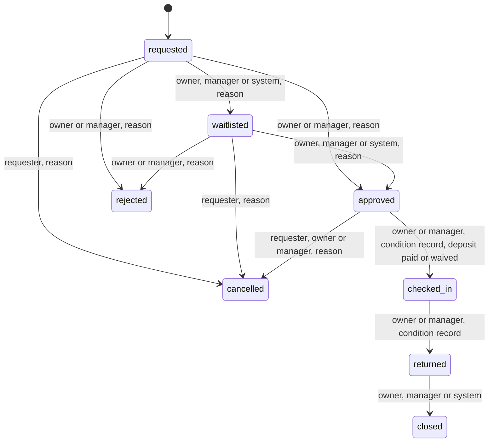

# SpareSlot build contract

Written inside the build window, by the contract session. Every other session reads this file and
`backend/src/main/resources/db/migration/V1__core_schema.sql`, `V2__photos.sql` and `V3__security_deposit.sql`
before writing code. If code and this file disagree, stop and ask the integrator (Manohar); do not pick a side
silently.

The schema is tested: `backend/src/test/resources/schema_rules_test.sql` runs 88 checks against a real
PostgreSQL 16 (double booking, illegal transitions, missing reasons, append-only audit log, photo rules, security
deposit rules).

## 1. What we are building

A local sharing network. Owner organisations (a college lab, a makerspace, a small studio) list equipment
and spaces. Students from any college, researchers, independent creators and early-stage teams request time
on them for free, within fair-use limits. Every decision carries a reason and an audit event, and a person
makes every approval, rejection and dispute decision.

Fictional demo data only. No real names, emails or institutions.

## 2. Roles and what each may do

| Action | Anyone | User | Manager (own org) | Owner (own org) | Admin |
|---|---|---|---|---|---|
| Browse and search resources | yes | yes | yes | yes | yes |
| Register, sign in | yes | | | | |
| File a verification request (credential) | | yes | | | |
| Review a verification request | | | yes | yes | |
| Create or edit resources, set conditions | | | | yes | |
| Add or remove listing photos of a resource | | | | yes | |
| Add condition photos to a booking (section 4a) | | requester | yes | yes | |
| See a booking's condition photos | | own bookings | own org | own org | |
| Pay the security deposit (section 4b) | | requester | | | |
| Waive, refund or forfeit a deposit | | | yes | yes | |
| See a booking's deposit and its ledger | | own bookings | own org | own org | |
| Request a booking, cancel own booking | | yes | | | |
| Approve, reject or waitlist a request | | | yes | yes | |
| Check in, record return condition | | | yes | yes | |
| Cancel an approved booking (with reason) | | requester | yes | yes | |
| Request an extension | | requester | | | |
| Decide an extension | | | yes | yes | |
| Raise an incident | | requester | yes | yes | |
| Resolve an incident | | | yes | yes | |
| Verify an organisation, suspend a user | | | | | yes |
| See a booking's audit timeline | | own bookings | own org | own org | all |

"Own org" means the organisation of the resource, taken from `users.org_id`. A manager or owner of another
organisation gets 404, not 403, so that existence is not leaked.

## 3. Booking state machine



The edges and the allowed roles live in the table `booking_transitions`; the trigger `bookings_guard`
refuses anything else. The application reads that table to decide which buttons to show.

Overdue is not a state. It is derived: `status = 'checked_in' AND end_at < now()`.

### Every transition does all of these, in one `@Transactional` method

1. Load the booking `FOR UPDATE`.
2. Check the actor against `booking_transitions.allowed_roles` (the requester counts as `requester`; staff must
   belong to the resource's organisation).
3. Require a new, non-blank `decision_reason` when `requires_reason` is true. A reason left over from the
   previous decision is refused by the database.
4. Apply the change and set `decided_by` (NULL for the system).
5. Insert one `audit_events` row: actor, role, action (`booking.approved`), from, to, reason.
6. Insert a `notifications` row for the other party.

`BookingService.transition(bookingId, target, reason, actor)` is the only code path that changes `bookings.status`.
Controllers never set it directly.

## 4. Eligibility and fair use

When a user submits a request, check in this order and stop at the first failure. A failure returns HTTP 422
with `{code, message, rule}` that says which rule blocked it and what to do. It does not create a booking and
is not a rejection.

1. The resource is active and its organisation is verified.
2. The window is in the future and no longer than `resources.max_booking_hours`.
3. Eligibility: the user holds a verified, unexpired credential of every kind in `resource_requirements`.
   If one is missing, the message names it and links to the verification request form.
4. Open requests: the user has at most 5 bookings in `requested` or `waitlisted`.
5. Quota: committed hours this week (`v_weekly_usage`, subject = the user's team or the user) plus this request
   must not exceed `resources.weekly_hour_cap`. A startup team counts as one subject.

Then:

6. If a live (`approved` or `checked_in`) booking overlaps, the system moves the request to `waitlisted` with a
   reason such as "Slot taken; you are number 2 in the queue". Otherwise it stays `requested` for a person.

Waitlist order: fewest hours in the last 30 days (`v_recent_usage_30d`), then earliest `created_at`.
When an approved booking is cancelled, the system offers the slot to the first waitlisted request that fits,
moving it to `approved` with the ranking as the reason, and notifies the manager, who may cancel it with a reason.
Rejections are only ever made by people.

The security deposit starts after approval and is described in section 4b. It plays no part in the checks above.

Overdue job (`@Scheduled`, every minute): for each overdue booking without an open `delay` incident, raise one
and notify both parties. Reminder one hour before `end_at`.

## 4a. Photos from both sides (V2)

Two kinds, in separate tables:

- **Listing photos** (`resource_photos`): the owner's pictures of a resource. Anyone can view them; only the
  owner of that organisation adds or removes them.
- **Condition photos** (`booking_photos`): evidence for one booking, taken by the borrower (`side = 'borrower'`)
  or by staff (`side = 'staff'`), tagged with a phase: `check_in`, `return` or `incident`. They can be added only
  while the booking is `approved`, `checked_in` or `returned`, and they can never be edited or deleted, so
  nobody can change the evidence after a dispute starts. Only the requester and the staff of the resource's
  organisation can see them.

Why both sides: the borrower photographs the item at pickup, so an existing scratch is not blamed on them; staff
photograph it on return; a damage incident then shows the two sets next to each other.

Rules the backend enforces before anything is inserted:

1. Accept JPEG, PNG and WebP only, up to 5 MB. Decide the type from the file's first bytes, never from the
   filename or the client's `Content-Type`.
2. Decode and re-encode the image, with the longest edge at most 1600 px. This also removes EXIF data, including
   the GPS location of where the photo was taken.
3. At most 6 photos per side per phase per booking.
4. The requester may add photos only to their own booking, and staff only to bookings of their own organisation
   (404 otherwise, as everywhere).
5. Every upload writes an `audit_events` row (`photo.added`, entity `booking`, the caption as the reason if given).
6. Serve booking photos only from `GET /api/photos/{id}/content`, after the same visibility check as the booking,
   with `Cache-Control: private` and `X-Content-Type-Options: nosniff`. Listing photos are served publicly.

The bytes are stored in PostgreSQL (`photo_blobs`), so they survive redeploys on hosts with an ephemeral disk.
List queries read only the metadata tables and never touch `photo_blobs`.

Where it ships: condition photos in S4, with check-in and return. Listing photos in S2 if time allows. Do not
build photos in S1.

The booking detail page shows a "Check-in" column and a "Return" column, each with the borrower's photos beside
the staff's photos, with who took each one and when.

## 4b. Security deposit (V3)

An owner can require a refundable deposit on a resource (`resources.deposit_minor`, in paise; 0 means none, and
the owner sets it in the resource form from S1). It applies to every borrower of that resource. A manager or
owner can waive it for one booking, with a reason.

The borrower pays it after approval and before pickup. It comes back only if the item was never taken, or came
back in its original condition.

| Step | What happens | Who |
|---|---|---|
| Approval | The service copies the resource's amount into the booking and sets `deposit_status = 'pending'` in the same update that approves it. | manager or owner |
| Payment | A `charge` row goes into the ledger and the database marks the deposit `paid`. | the borrower |
| Pickup | Check-in is refused until the deposit is `paid`, `waived` or `none`. | database |
| Return | Staff record the return condition. A check-in and a return condition record are both required. | manager or owner |
| Refund | A `refund` row is allowed only if the booking was cancelled before pickup, or the booking is `returned` in original condition. | manager or owner |
| Forfeit | A `forfeit` row is allowed only after a damage incident on the booking is `resolved`. All or nothing; there are no partial deductions. | manager or owner |
| Waive | A `waive` row with a reason, while the deposit is `pending`. | manager or owner |
| Close | The booking cannot close while the deposit is still `paid` or `pending`. | database |

**Original condition** means the return condition is not worse than the check-in condition (good, then
minor_wear, then damaged), and no damage or dispute incident on the booking is still open. An item that was
already damaged at pickup and came back the same way counts as original condition, which is why the borrower's
own check-in photos matter.

**Rules for the backend**

1. `DepositService` is the only code that writes `deposit_transactions`. In one transaction it checks the actor
   (the requester pays; staff of the resource's organisation waive, refund or forfeit), inserts the ledger row,
   writes an `audit_events` row (`deposit.charged`, `deposit.refunded`, `deposit.forfeited`, `deposit.waived`)
   and a notification. It never writes `bookings.deposit_status`; the database refuses that and updates it
   itself when a ledger row is inserted.
2. A person decides every refund after a return and every forfeit. The system does not. The one automatic
   refund is a cancellation before pickup: cancelling an approved booking with a paid deposit refunds it in the
   same transaction, with the cancellation reason. `v_deposits_to_resolve` is the staff to-do list and its
   `recommended_action` is advice only.
3. While a damage or dispute incident is open, nothing is refunded or forfeited. A borrower who disagrees
   raises a dispute incident, and the decision waits for it.
4. Payments go through a `PaymentProvider` interface. This build ships `DemoPaymentProvider`, which moves no
   money; every screen that shows it says "Demo payment: no real money moves". The schema also allows
   `razorpay_test` for a stretch goal in test mode. Store no card, UPI or bank details anywhere, only
   `provider` and `provider_ref`. Currency is INR.
5. A rule failure returns 422 with the rule in plain words (for example "Pay the deposit before pickup"). The
   database messages are for logs, not for users.

**For the frontend:** the booking page has a Deposit panel with the amount, a status chip and the ledger as a
timeline (who, what, when, why). Buttons come from `allowedActions`: `pay_deposit` for the borrower and
`waive_deposit`, `refund_deposit`, `forfeit_deposit` for staff. Beside a refund or forfeit decision, show the
check-in and return condition and the photos from both sides (section 4a).

Where it ships: the deposit field on the resource form in S1; everything else in S4, with check-in and return.
Do not build the payment flow in S1.

## 5. Auth and role-based access in Spring Boot

Decision: stateless JWT with Spring Security 6. Roles are coarse and checked with `@PreAuthorize`; organisation
scoping is checked in the service, because a role alone does not say which organisation.

**Login.** `POST /api/auth/login` verifies the password with `BCryptPasswordEncoder` and returns a JWT
(HS256, 8 hours, no refresh) with claims `sub` (user id), `role` and `org` (organisation id or absent).
The secret comes from the environment variable `JWT_SECRET`; it is never committed.

**Resource server.** Use `spring-boot-starter-oauth2-resource-server` with a `NimbusJwtDecoder` built from
the secret. This avoids writing a filter by hand.

```java
@Configuration
@EnableMethodSecurity
class SecurityConfig {
  @Bean
  SecurityFilterChain api(HttpSecurity http) throws Exception {
    return http
      .csrf(csrf -> csrf.disable())                               // stateless, bearer tokens
      .sessionManagement(s -> s.sessionCreationPolicy(SessionCreationPolicy.STATELESS))
      .cors(Customizer.withDefaults())
      .authorizeHttpRequests(a -> a
        .requestMatchers("/api/auth/**", "/actuator/health").permitAll()
        .requestMatchers(HttpMethod.GET, "/api/resources/**").permitAll()   // browsing is public; writes need a token
        .anyRequest().authenticated())
      .oauth2ResourceServer(o -> o.jwt(j -> j.jwtAuthenticationConverter(roleConverter())))
      .build();
  }

  // role claim "manager" becomes authority ROLE_MANAGER
  private JwtAuthenticationConverter roleConverter() {
    var c = new JwtAuthenticationConverter();
    c.setJwtGrantedAuthoritiesConverter(jwt ->
        List.of(new SimpleGrantedAuthority("ROLE_" + jwt.getClaimAsString("role").toUpperCase())));
    return c;
  }
}
```

**Coarse check on the controller:**

```java
@PostMapping("/{id}/decision")
@PreAuthorize("hasAnyRole('OWNER','MANAGER')")
public BookingView decide(@PathVariable UUID id, @RequestBody DecisionRequest body,
                          @AuthenticationPrincipal Jwt jwt) { ... }
```

**Scoping check in the service.** The controller passes an `Actor(userId, role, orgId)` built from the JWT, never
from the request body. `BookingService.transition` loads the booking, compares `resource.orgId` with
`actor.orgId()`, and throws `NotFoundException` (HTTP 404) on a mismatch.

**Rules**

- Actor id and role in `audit_events` always come from the token.
- A suspended user (`users.status = 'suspended'`) is refused at login.
- Every protected endpoint has a test for the wrong role (expects 403) and for another organisation (expects 404).
  Make it a table-driven test: one row per endpoint and role.
- CORS allows only the frontend origin, from configuration.

## 6. API outline

All paths are under `/api`. Errors use `{code, message, rule?}`. Lists are paged with `?page=&size=`.

| Method and path | Who | Purpose |
|---|---|---|
| POST `/auth/register`, `/auth/login` | anyone | create a user, get a token |
| GET `/me` | any signed-in user | profile, role, verification status |
| GET `/resources?category=&q=&orgId=` | anyone | search and filter |
| GET `/resources/{id}` | anyone | detail with conditions, eligibility rules, free slots |
| POST, PUT `/resources` | owner | create or edit a resource in own organisation |
| POST `/credentials` | user | file a verification request |
| GET `/credentials?status=pending` | manager, owner | review queue |
| POST `/credentials/{id}/review` | manager, owner | `{decision: verified or rejected, reason}` |
| POST `/bookings` | user | request a booking (section 4 checks) |
| GET `/bookings?mine=true` or `?orgId=&status=` | user, manager, owner | lists |
| GET `/bookings/{id}` | participants and own-org staff | detail, `allowedActions`, queue position |
| GET `/bookings/{id}/events` | same | audit timeline |
| POST `/bookings/{id}/decision` | manager, owner | `{action: approve, reject or waitlist, reason}` |
| POST `/bookings/{id}/cancel` | requester, manager, owner | `{reason}` |
| POST `/bookings/{id}/check-in`, `/return` | manager, owner | `{rating, notes}` (photos are uploaded separately) |
| POST `/bookings/{id}/photos` | requester, manager, owner | multipart `file`, `phase`, `caption?` (section 4a) |
| GET `/bookings/{id}/photos` | participants and own-org staff | metadata only: id, phase, side, caption, who, when |
| GET `/photos/{id}/content` | participants and own-org staff | the image bytes |
| POST `/resources/{id}/photos`, DELETE `/resources/{id}/photos/{photoId}` | owner | listing photos |
| GET `/resources/{id}/photos`, GET `/resource-photos/{id}/content` | anyone | listing photos |
| GET `/bookings/{id}/deposit` | participants and own-org staff | amount, status, ledger (section 4b) |
| POST `/bookings/{id}/deposit/pay` | requester | pays through the payment provider (demo) |
| POST `/bookings/{id}/deposit/waive`, `/refund`, `/forfeit` | manager, owner | `{reason}`; 422 with the rule if not allowed |
| GET `/deposits/to-resolve` | manager, owner | deposits held for finished bookings, own organisation |
| POST `/bookings/{id}/extensions` | requester | `{requestedEndAt, reason}` |
| POST `/extensions/{id}/decision` | manager, owner | `{action, reason}` |
| POST `/incidents`, `/incidents/{id}/resolve` | see section 2 | raise and resolve |
| GET `/notifications`, POST `/notifications/{id}/read` | signed in | polled by the UI |
| GET `/admin/organisations`, POST `/admin/organisations/{id}/verify` | admin | organisation verification |

`allowedActions` in the booking detail is computed on the server from `booking_transitions` and the actor, so the
frontend never reimplements the rules.

## 7. Slices and done-when

Same slices as the requirements document. Each is finished only when its done-when sentence is true on the
deployed app.

| Slice | Hours | Done when |
|---|---|---|
| S1 | 0 to 12 | A manager approves a request and the audit log shows it |
| S2 | 12 to 20 | A user missing a credential is blocked, and a manager can verify them |
| S3 | 20 to 28 | A competing request is waitlisted with a visible reason |
| S4 | 28 to 36 | A booking runs from approval to a closed return, with its deposit paid and settled, including a damage incident |
| S5 | 36 to 40 | A judge completes the journey unaided |
| S6 | 40 to 48 | All seven items are submitted with a buffer |

Cut order if behind: AI features, listing photos, extensions, search polish. Never cut the audit log, the
decision reasons or the return flow. Condition photos and the deposit stay unless the return flow itself is at risk.

## 8. Decisions taken (change only with the integrator)

- Java 21, Spring Boot 3, Maven, PostgreSQL 16, Flyway. Frontend: React, Vite, TypeScript.
- Staff belong to one organisation. A team shares one quota. The deposit applies to every borrower when the owner
  sets an amount, and staff may waive it with a reason. Payment is a demo provider that moves no real money.
- Opening hours and per-resource calendars are not modelled: any future window is bookable until conflicts say otherwise.
- Photos are optional and stored in PostgreSQL, not on disk (section 4a). Both borrower and staff can add them.
- No email, no websockets, no payments. Notifications are rows the UI polls every 30 seconds.
- Passwords: BCrypt. Demo password for all seeded users is set in the seed migration, never in the README of a
  deployed app.
- Seed data may insert bookings in any status directly (the guard only checks updates); it must still follow the
  overlap rule.
